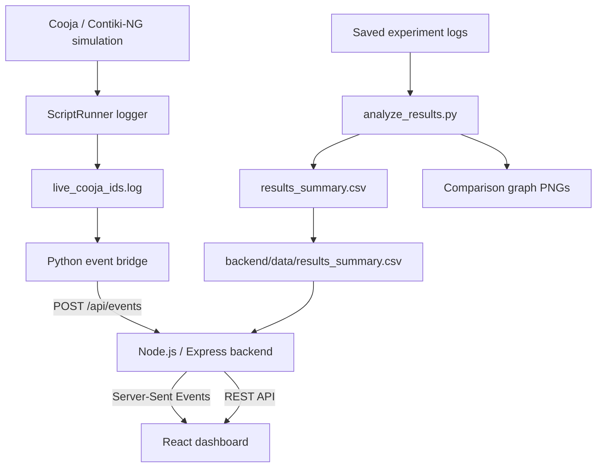

# Secure IoT Network with Intrusion Detection in Contiki

**Subtitle:** Lightweight Anomaly and Attack Mitigation for Constrained 6LoWPAN Networks

A simulation-based IoT network security project built with **Contiki-NG, Cooja, a lightweight intrusion detection system (IDS), Python, Node.js/Express, Server-Sent Events (SSE), and React**.

The project simulates Flooding and Sinkhole attacks in a five-mote 6LoWPAN/RPL network, observes attack-related messages, applies IDS detection and mitigation, measures selected network/response metrics, and presents the results in a web dashboard.

> **Simulation only:** The included experiments run in Cooja. They do not represent tests on physical IoT hardware. Results depend on the selected simulation, duration, and log files.

## Contents

- [What the project does](#what-the-project-does)
- [Architecture](#architecture)
- [Technology stack](#technology-stack)
- [Repository structure](#repository-structure)
- [Prerequisites](#prerequisites)
- [1. Install Ubuntu with WSL on Windows](#1-install-ubuntu-with-wsl-on-windows)
- [2. Install development tools in Ubuntu](#2-install-development-tools-in-ubuntu)
- [3. Install Contiki-NG and Cooja](#3-install-contiki-ng-and-cooja)
- [4. Clone this project](#4-clone-this-project)
- [5. Install the app dependencies](#5-install-the-app-dependencies)
- [6. Build and open the simulations](#6-build-and-open-the-simulations)
- [7. Run the dashboard](#7-run-the-dashboard)
- [8. Show live IDS events](#8-show-live-ids-events)
- [9. Analyze experiment logs](#9-analyze-experiment-logs)
- [10. Finish and save a simulation](#10-finish-and-save-a-simulation)
- [Observed example results](#observed-example-results)
- [Troubleshooting](#troubleshooting)
- [Known limitations and reproducibility notes](#known-limitations-and-reproducibility-notes)
- [Contributing](#contributing)
- [Publish this project to GitHub](#publish-this-project-to-github)
- [References](#references)

## What the project does

The simulated network contains five motes:

| Mote | Role |
|---|---|
| Mote 1 | RPL root / UDP server; performs IDS functions in protected simulations |
| Motes 2–4 | Normal IoT nodes generating ordinary application traffic |
| Mote 5 | Attacker node in Flooding and Sinkhole scenarios |

### Flooding attack

The attacker sends UDP packets at a high rate. In the protected simulation, the IDS monitors the incoming traffic rate; when the configured threshold is crossed, it reports the detection, blacklists the source, sends a `BLOCK` message, and the attacker stops flooding after receiving that message.

### Sinkhole attack

The attacker advertises an attractive false RPL rank to influence route selection. In the protected simulation, the IDS detects the suspicious rank, sends a block action, isolates the attacker, and triggers an RPL global repair. The resulting log records the detection and mitigation sequence.

### Dashboard and experiment analysis

- A Python analyzer reads saved Cooja logs, calculates the metrics implemented in the project, writes `results_summary.csv`, and generates comparison graphs.
- An Express backend serves the results and accepts IDS events.
- A Python event bridge tails the live Cooja log and sends recognized events to the backend.
- The React frontend reads historical metrics through REST endpoints and receives live events through SSE.

## Architecture



The system has two related but separate data paths:

1. **Live-event path:** Cooja logger → `live_cooja_ids.log` → Python bridge → Express `/api/events` → SSE → React.
2. **Historical-results path:** saved experiment logs → `analyze_results.py` → `results_summary.csv` → backend CSV copy → dashboard charts and comparison panels.

Saving a log alone does not update the historical dashboard. Run the analyzer and copy the generated CSV to the backend data folder to update those metrics.

## Technology stack

- **Simulation/network:** Contiki-NG release `v5.2`, Cooja, RPL Lite, 6LoWPAN, CSMA, UDP
- **Mote firmware:** C
- **Log analysis and event bridge:** Python 3
- **Backend:** Node.js, Express, REST API, SSE
- **Frontend:** React, Vite, Axios, Recharts, Lucide icons
- **Environment used for development:** Windows 11 with Ubuntu on WSL 2

## Repository structure

The following is the intended high-level layout. Some optional logs, generated graphs, and scenario files may differ depending on which experiment artifacts are committed.

```text
secure-iot-ids/
├── README.md
├── .gitignore
├── normal/                          # IDS/root server and normal-node source
├── flood/                           # Flood attacker source
├── sinkhole/                        # Sinkhole scenario source/configuration
├── sinkhole_no_ids/                 # Unprotected sinkhole scenario files
├── sinkhole_fast_ids/               # Final protected sinkhole scenario
├── sinkhole_routing_diag/           # Optional routing diagnostics
├── bridge/
│   ├── secure_iot_event_bridge.py   # Log-to-backend event bridge
│   └── cooja_live_logger.js         # Cooja ScriptRunner logger
├── backend/
│   ├── server.js
│   ├── package.json
│   └── data/results_summary.csv
├── frontend/
│   ├── package.json
│   └── src/                         # React dashboard
├── analyze_results.py               # Offline metrics and graph generation
├── prepare_experiment.sh             # Archive/prepare helper (if included)
├── finish_experiment.sh              # Validate/archive/save helper (if included)
├── Secure_IoT_Normal.csc
├── Secure_IoT_Flooding_No_IDS.csc
├── Secure_IoT_Flooding_Final.csc
├── results_summary.csv
└── *_log.txt                         # Canonical experiment logs, if included
```

The Contiki-NG checkout is a **separate sibling directory**, not a subfolder of this repository:

```text
~/
├── contiki-ng/
└── secure-iot-ids/
```

This sibling layout is important because the mote projects use relative paths such as `../../contiki-ng` in their Makefiles. Keep the project folder named `secure-iot-ids` unless you also update those paths and any paths saved in Cooja simulation files.

## Prerequisites

- Windows 11 (or another supported Linux environment)
- WSL 2 with Ubuntu and WSLg for graphical applications on Windows
- Git
- Contiki-NG `release/v5.2` and its submodules
- A JDK compatible with this Contiki-NG/Cooja setup (the development environment used JDK 25)
- Node.js 22 LTS or another version compatible with the project's Vite version
- Python 3 and Matplotlib for graph generation
- Internet connection for cloning repositories and installing packages

## 1. Install Ubuntu with WSL on Windows

Skip this section if Ubuntu under WSL is already working.

1. Open **PowerShell as Administrator** (Start menu → PowerShell → Run as administrator).
2. Install WSL and Ubuntu:

   ```powershell
   wsl --install -d Ubuntu
   ```

3. Restart Windows if requested.
4. Open **Ubuntu** from the Windows Start menu. On first launch, wait for setup to finish, then create a Linux username and password. Password characters normally do not appear while typing in the Linux terminal.
5. Check WSL from PowerShell:

   ```powershell
   wsl --list --verbose
   ```

Use Ubuntu for the Linux commands below, not PowerShell. The WSL install process and requirements are documented by Microsoft: https://learn.microsoft.com/windows/wsl/install

## 2. Install development tools in Ubuntu

Open **Ubuntu / WSL**. Administrator is not needed for the terminal, but `sudo` is used below to install system packages.

```bash
sudo apt update
sudo apt install -y git git-lfs build-essential make cmake gcc g++ curl wget unzip zip \
  python3 python3-pip python3-venv python3-matplotlib
```

Install the JDK needed by the selected Contiki-NG/Cooja version. The development environment for this project used Java 25:

```bash
sudo apt install -y openjdk-25-jdk
java -version
javac -version
```

If `openjdk-25-jdk` is not available for your Ubuntu release, consult the official Contiki-NG Linux toolchain guide before selecting another JDK: https://github.com/contiki-ng/contiki-ng/blob/develop/doc/getting-started/Toolchain-installation-on-Linux.md

### Install Node.js 22 using NVM

Using NVM keeps Linux Node/npm separate from Windows Node/npm, which helps avoid path issues when working inside WSL.

```bash
curl -o- https://raw.githubusercontent.com/nvm-sh/nvm/v0.40.8/install.sh | bash
source ~/.bashrc
nvm install 22
nvm alias default 22
node -v
npm -v
command -v node
command -v npm
```

Ensure `node` and `npm` resolve to Linux paths inside Ubuntu, not a Windows path such as `/mnt/c/Program Files/nodejs/npm`. See the NVM instructions at https://github.com/nvm-sh/nvm.

## 3. Install Contiki-NG and Cooja

Clone the tested Contiki-NG branch into `~/contiki-ng` and initialize its submodules:

```bash
cd ~
git clone --branch release/v5.2 https://github.com/contiki-ng/contiki-ng.git contiki-ng
cd ~/contiki-ng
git submodule update --init --recursive
```

Build Cooja:

```bash
cd ~/contiki-ng/tools/cooja
./gradlew jar
```

To launch Cooja from Ubuntu:

```bash
cd ~/contiki-ng/tools/cooja
./gradlew run
```

On Windows 11, WSLg normally supports Linux GUI applications. If Cooja does not open, check the Java version and the official Contiki-NG Cooja tutorial: https://github.com/contiki-ng/contiki-ng/blob/develop/doc/tutorials/Running-Contiki-NG-in-Cooja.md

## 4. Clone this project

Create an empty GitHub repository first (the upload instructions are below), then replace `<YOUR-GITHUB-USERNAME>` with your GitHub username:

```bash
cd ~
git clone https://github.com/<YOUR-GITHUB-USERNAME>/secure-iot-ids.git
cd ~/secure-iot-ids
```

If you already have this project folder locally, do not clone it over the existing folder. Ensure the project and Contiki checkouts are siblings as shown above.

### Check Cooja paths after cloning

Cooja `.csc` files and the logger may contain paths from the original developer machine. If your Linux username or repository location differs, update those saved paths before running the simulation. In particular, set the logger's `LOG_PATH` in `bridge/cooja_live_logger.js` to the path where your checkout writes `live_cooja_ids.log`.

For a portable Cooja ScriptRunner logger, the path can be based on the Linux home directory rather than hard-coding `/home/yash`:

```javascript
var LOG_PATH = java.lang.System.getProperty("user.home") + "/secure-iot-ids/live_cooja_ids.log";
```

Use this line in the logger script in place of a machine-specific `LOG_PATH`. Verify that the logger writes a `SCRIPT_LOGGER_STARTED` line and then appends new simulation messages before starting the bridge.

## 5. Install the app dependencies

### Backend

Open an Ubuntu terminal:

```bash
cd ~/secure-iot-ids/backend
npm ci
```

### Frontend

Open another Ubuntu terminal:

```bash
cd ~/secure-iot-ids/frontend
npm ci
```

Do not upload either folder's `node_modules`; npm installs these from `package.json` and `package-lock.json`.

## 6. Build and open the simulations

The source folders include Makefiles for building the mote firmware. Run the build command from each scenario source folder that contains a `Makefile`:

```bash
cd ~/secure-iot-ids/normal && make TARGET=cooja
cd ~/secure-iot-ids/flood && make TARGET=cooja
cd ~/secure-iot-ids/sinkhole && make TARGET=cooja
```

If the checkout includes additional source folders with a `Makefile` (for example `sinkhole_no_ids` or `sinkhole_fast_ids`), build those in the same way. If a simulation loads already-built firmware, Cooja may also compile mote sources when the simulation is opened. Resolve any missing-source or firmware paths using files from this repository; do not edit the original reference example at `~/contiki-ng/examples/rpl-udp/`.

Open the relevant simulation in Cooja with **File → Open Simulation**:

| Scenario | Simulation file |
|---|---|
| Normal baseline | `~/secure-iot-ids/Secure_IoT_Normal.csc` |
| Flooding without IDS | `~/secure-iot-ids/Secure_IoT_Flooding_No_IDS.csc` |
| Flooding with IDS | `~/secure-iot-ids/Secure_IoT_Flooding_Final.csc` |
| Sinkhole without IDS | `~/secure-iot-ids/sinkhole_no_ids/Secure_IoT_Sinkhole_No_IDS.csc` |
| Sinkhole with IDS (final) | `~/secure-iot-ids/sinkhole_fast_ids/Secure_IoT_Sinkhole_IDS_Final.csc` |

The exact set of `.csc` files committed may differ from this table; use the final simulation files that are present in the checkout. Start the simulation from time zero for a fresh run.

## 7. Run the dashboard

You need a separate terminal for each long-running process. Leave the backend and frontend terminals open while testing.

### Terminal A — start the backend

```bash
cd ~/secure-iot-ids/backend
node server.js
```

The backend listens at `http://localhost:5000`.

Check it in another terminal or browser:

```bash
curl http://localhost:5000/api/health
```

The response should report an `OK` status.

### Terminal B — start the frontend

```bash
cd ~/secure-iot-ids/frontend
node node_modules/vite/bin/vite.js --host 0.0.0.0
```

Open http://localhost:5173 in the Windows browser. The direct Node/Vite command is included because it worked around a Windows-path/npm-shell issue observed in the original WSL development environment.

The dashboard includes historical scenario metrics, Flooding/Sinkhole attack summaries, charts, a five-mote topology illustration, IDS summaries, and separate live-event panels. The topology is a dashboard representation; it is not a live Cooja radio-topology feed.

## 8. Show live IDS events

Live events will not reach the frontend unless the Cooja logger, Python bridge, backend, and frontend are all running.

1. Start Terminal A (backend) and Terminal B (frontend) as above.
2. In Cooja, open the desired simulation and make sure the ScriptRunner logger is active. The logger must write to `~/secure-iot-ids/live_cooja_ids.log`.
3. For a clean demo, stop any old simulation. In Ubuntu, clear the live log and its bridge offset state:

   ```bash
   : > ~/secure-iot-ids/live_cooja_ids.log
   rm -f ~/secure-iot-ids/live_cooja_ids.log.bridge-state.json
   ```

4. Open **Terminal C — Python bridge** and start it **before** starting the Cooja simulation:

   ```bash
   cd ~/secure-iot-ids/bridge
   python3 secure_iot_event_bridge.py \
     --file ~/secure-iot-ids/live_cooja_ids.log \
     --follow
   ```

5. Leave Terminal C open. Activate the logger, reset/reopen the Cooja simulation to time zero if needed, and click Run.
6. Watch the bridge terminal and the Live IDS Events panel in the dashboard.

Expected protected Flooding events include detection, block sent, mitigation, and attacker stopped. Expected protected Sinkhole events include detection, block sent, isolation, RPL repair, and subsequent mitigation messages.

For the live demo, **do not** use `--dry-run`, because dry-run validates parsing without sending events to the backend. The bridge supports `--once` for a completed log and `--follow` for a growing live log.

## 9. Analyze experiment logs

When the canonical experiment logs are in place, run the analyzer:

```bash
cd ~/secure-iot-ids
python3 analyze_results.py
```

This produces/updates:

- `results_summary.csv`
- comparison graphs such as `pdr_comparison.png`, `flood_packets_comparison.png`, `ids_response_time.png`, `sinkhole_dio_comparison.png`, and `sinkhole_response_time.png` (depending on analyzer configuration and available data)

The backend reads its own CSV copy, so update it after analysis:

```bash
cp ~/secure-iot-ids/results_summary.csv \
   ~/secure-iot-ids/backend/data/results_summary.csv
```

Then use the dashboard's **Refresh** control or reload the page. The live-event bridge is separate from this historical-results process.

## 10. Finish and save a simulation

If `finish_experiment.sh` is present in the checkout, run it after the relevant simulation and logger output are complete. Example scenario names:

```bash
cd ~/secure-iot-ids && ./finish_experiment.sh flood_no_ids
cd ~/secure-iot-ids && ./finish_experiment.sh flood_ids
cd ~/secure-iot-ids && ./finish_experiment.sh sinkhole_no_ids
cd ~/secure-iot-ids && ./finish_experiment.sh sinkhole_ids
```

Run only the command matching the scenario you just simulated. A validation failure means the script did not replace the canonical log; follow the message printed by the script rather than manually editing a log. The helper is a project-specific convenience, not a replacement for checking that the intended simulation and logger were used.

## Observed example results

The current dashboard screenshot supplied with this project showed the following example values:

| Metric | Flooding without IDS | Flooding with IDS |
|---|---:|---:|
| Observed flood packets | 2,951 | 6 |
| Average latency displayed | 73 ms | 47 ms |
| IDS detection time | — | 509 ms |
| BLOCK / mitigation response | — | 10 ms |

The screenshot's Sinkhole panel showed 17 DIO advertisements in the No-IDS baseline and 1 in the protected run, with detection shown as 667 ms and mitigation response as 10 ms. The Sinkhole No-IDS log is an older development baseline and was affected by an earlier fake-rank behavior issue; treat that comparison as **preliminary**, not as a fully controlled experiment pair.

These numbers are examples from a project run/dashboard snapshot, not guarantees for every run. Read `results_summary.csv` to determine which measurements are included in a specific checkout. Do not label the later attacker-stop print delay as the actual IDS mitigation time; the project's measured BLOCK-response metric is approximately 10 ms in the cited run.

## Troubleshooting

### The frontend loads but no live events appear

- Confirm `node server.js` is still running in the backend terminal.
- Confirm the Vite terminal is still running and the page says the backend/stream is online.
- Confirm the Cooja logger is writing fresh lines to `live_cooja_ids.log`.
- Start the Python bridge **before** running the simulation and leave it running.
- Make sure you opened a protected simulation for IDS alerts. A No-IDS run should not generate IDS detection/mitigation events.
- Check that the logger's `LOG_PATH` matches the actual WSL project path.

### `npm` or `vite` tries to start Windows CMD from WSL

Use the Node installation managed by NVM and check:

```bash
command -v node
command -v npm
```

The paths should belong to Ubuntu/WSL, not `/mnt/c/Program Files/nodejs/`. Start Vite with:

```bash
cd ~/secure-iot-ids/frontend
node node_modules/vite/bin/vite.js --host 0.0.0.0
```

### Cooja cannot find firmware or C source

- Confirm Contiki-NG exists at `~/contiki-ng` and the project at `~/secure-iot-ids`.
- Compile the relevant mote project using `make TARGET=cooja`.
- Open the matching `.csc` file from this repository.
- Update stale absolute paths stored in the simulation configuration if the project is in a different location.

### The analyzer reports missing logs or unexpected counts

- Confirm you are in `~/secure-iot-ids`.
- Confirm the relevant canonical logs exist and are from the intended scenario.
- Do not use the combined `live_cooja_ids.log` as a canonical historical log; it may contain multiple live sessions.
- Run `python3 analyze_results.py` only after the canonical logs are ready, then copy `results_summary.csv` to `backend/data/`.

## Known limitations and reproducibility notes

- This project is a Cooja simulation; behavior and metrics depend on the simulation configuration, randomization, duration, and log contents.
- Live events are held in backend memory and are cleared when the backend restarts. The CSV is the file used for historical dashboard measurements.
- The dashboard topology is a visual representation of the five-mote roles and recent event state, not a real-time topology map imported from Cooja.
- The Sinkhole No-IDS logs described above are from development experiments. Re-run a matched No-IDS/IDS pair before making strong quantitative claims about the Sinkhole protection rate.
- The original reference example at `~/contiki-ng/examples/rpl-udp/` should be treated as upstream reference material and left unchanged.
- Review every experiment's saved log and generated CSV before using the results in an academic submission.

## Contributing

1. Create a branch for the change.
2. Keep generated output, live logs, local archives, `node_modules`, and machine-specific files out of commits.
3. Describe the simulation, source change, and how the result was verified.
4. Do not publish credentials, `.env` files, personal access tokens, or private data.

## Publish this project to GitHub

### A. Create an empty GitHub repository

1. Sign in at https://github.com/new.
2. Use the repository name `secure-iot-ids`.
3. Choose **Public** only if the team is comfortable making the source public; otherwise start with **Private**.
4. Do not select options to add a README, license, or `.gitignore` because those files are already in this project.
5. Create the repository and copy its HTTPS URL, which will look like `https://github.com/<YOUR-GITHUB-USERNAME>/secure-iot-ids.git`.

### B. Copy in the README and `.gitignore`

Place the supplied `README.md` and `.gitignore` in the root of `~/secure-iot-ids`, alongside `analyze_results.py` and the scenario folders. Do not place them inside `frontend/` or `backend/`.

### C. Review what Git will upload

Run in Ubuntu / WSL:

```bash
cd ~/secure-iot-ids
git status --short
```

If Git says this is not a repository, initialize it:

```bash
git init -b main
```

If it is already a Git repository, do not initialize it again. Make sure `.gitignore` exists at the root, then stage the project files:

```bash
git add .
git status --short
git diff --cached --stat
git diff --cached --name-only
```

Review the staged file list before committing. Check that it does **not** contain `node_modules/`, frontend `dist/`, build/compiled objects, `.env` files, tokens/passwords, `live_cooja_ids.log`, bridge-state JSON, or large experiment archives. The root-level validated scenario logs and `results_summary.csv` may be included if they are the intended artifacts for this version. Never upload credentials or private tokens.

### D. Commit and push

Set the name/email used in commits if Git asks you to:

```bash
git config --global user.name "Your Name"
git config --global user.email "you@example.com"
```

Create the initial commit:

```bash
git commit -m "Initial commit: Secure IoT IDS project"
```

Add the GitHub remote (replace the placeholder with your real GitHub username):

```bash
git remote add origin https://github.com/<YOUR-GITHUB-USERNAME>/secure-iot-ids.git
git branch -M main
git push -u origin main
```

If `git remote add origin` says `origin` already exists, check it first:

```bash
git remote -v
```

If it points to the wrong repository, update it instead of adding a second remote:

```bash
git remote set-url origin https://github.com/<YOUR-GITHUB-USERNAME>/secure-iot-ids.git
```

Then run `git push -u origin main`. Follow GitHub's browser/credential prompts. GitHub account passwords are not accepted as Git HTTPS passwords; use the approved browser sign-in, a personal access token, GitHub CLI, or SSH authentication if prompted.

### E. Future updates

After editing source files or documentation:

```bash
cd ~/secure-iot-ids
git status --short
git add .
git diff --cached --stat
git commit -m "Describe your change"
git push
```

Check the staged file list before every commit. `.gitignore` prevents common generated files from being added, but it cannot remove files that were already tracked in an earlier commit.

## References

- Microsoft: Install WSL — https://learn.microsoft.com/windows/wsl/install
- Contiki-NG: Linux toolchain installation — https://github.com/contiki-ng/contiki-ng/blob/develop/doc/getting-started/Toolchain-installation-on-Linux.md
- Contiki-NG: Running Contiki-NG in Cooja — https://github.com/contiki-ng/contiki-ng/blob/develop/doc/tutorials/Running-Contiki-NG-in-Cooja.md
- NVM (Node Version Manager) — https://github.com/nvm-sh/nvm
- GitHub Docs: Add locally hosted code to GitHub — https://docs.github.com/en/migrations/importing-source-code/using-the-command-line-to-import-source-code/adding-locally-hosted-code-to-github
- GitHub Docs: Ignoring files — https://docs.github.com/en/get-started/git-basics/ignoring-files
